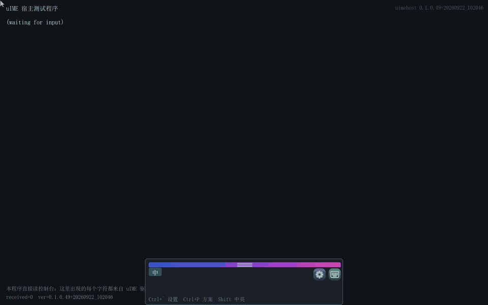
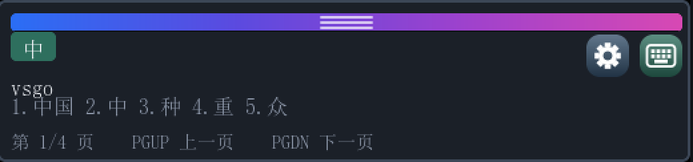
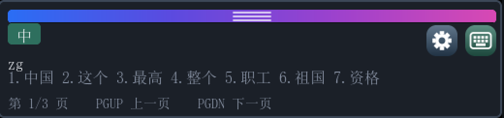
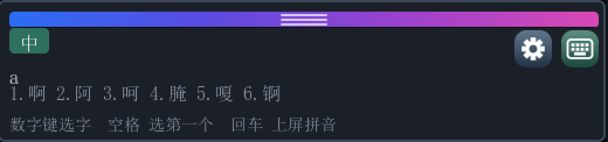
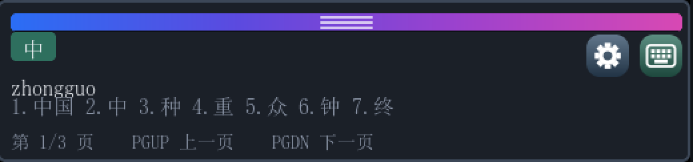
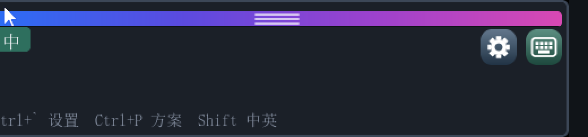
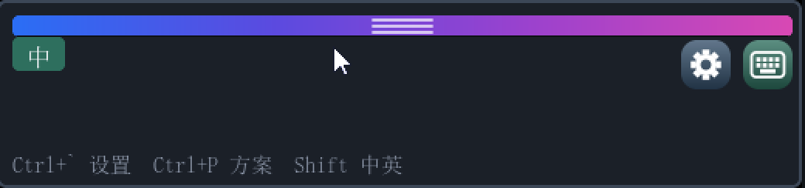
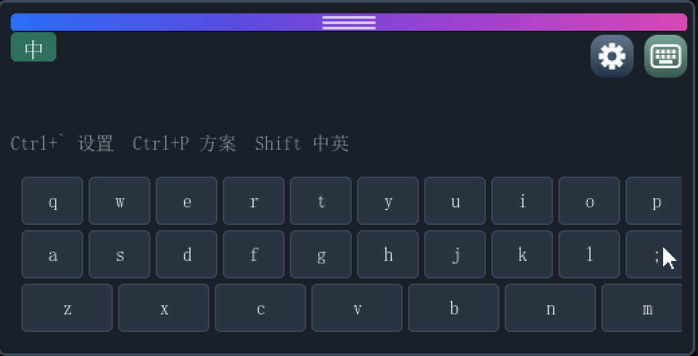
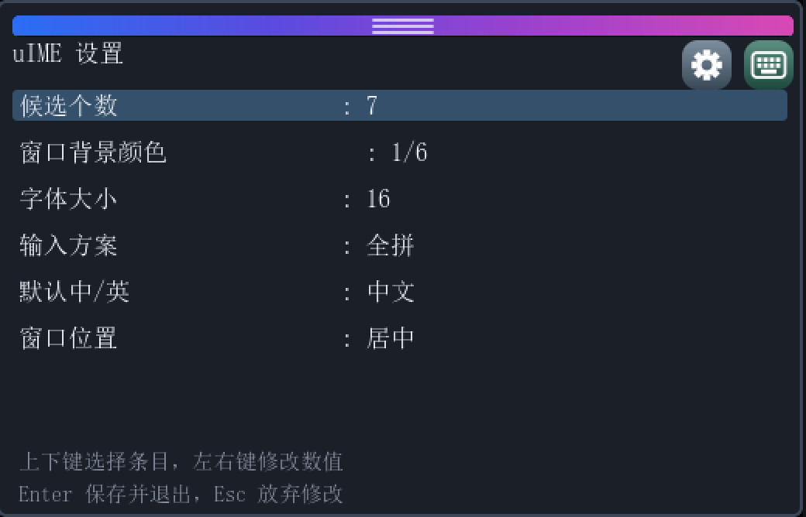
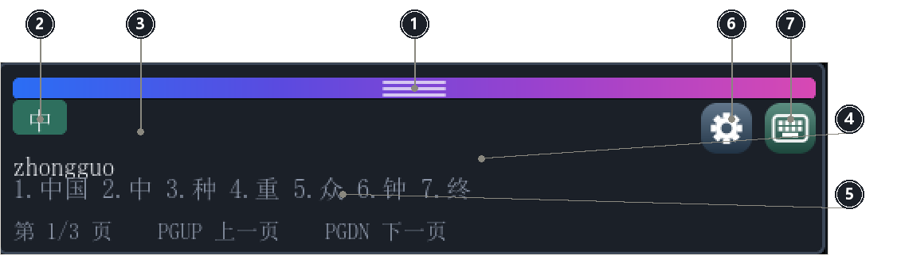

# uIME — UEFI Shell 中文输入法

> 中文 ｜ [English](#english)

**给 UEFI 环境用的中文输入法。** 它以常驻驱动的形式加载，接管控制台输入，把你敲的拼音翻译成
汉字送出去——**之后启动的 UEFI 程序，只要读键盘，就能直接收到汉字**。输入法的候选窗、软键盘、
设置面板以悬浮窗的形式盖在宿主程序画面上，不用改宿主一行代码。

当前版本 **v0.1.0.49**（2026-09-22）·
[下载最新发布](https://github.com/MikeWuPing/uIME/releases/latest) ·
[产品手册](docs/manual/index.html) · [集成指南](docs/uIME-集成指南.pdf)



*一段连续演示，无剪辑：在演示宿主里用拼音打出「大小」「左右」并上屏 → 把输入法窗口拖到
左 / 右 / 居中 / 上方四个停靠位 → 打开设置逐行看六项选项 → 最后用软键盘点出「南京」。*

> **想把它接进你自己的 UEFI 程序？** 看[集成指南](docs/uIME-集成指南.pdf)（Word / PDF 双语）。
> 里面写清楚了交付物是哪个文件、启动顺序为什么是强制的、宿主为什么零改动，以及固件内集成的
> 两个坑和集成检查清单。

---

## 一、它解决什么问题

UEFI Shell 和绝大多数 UEFI 应用只认 ASCII：键盘送进来的是 `EFI_INPUT_KEY.UnicodeChar`，
汉字根本进不来。想在固件里给一个文件起中文名、在固件自带的编辑器里写中文、在自己写的
UEFI 工具里接受中文输入——此前没有任何输入手段。

uIME 把「输入法」这件事放在**控制台输入层**：驱动装上之后，之后启动的程序读键盘时，
汉字就像普通按键一样到达。**宿主程序不需要为中文做任何改动。**

## 二、功能

### 拼音输入：全拼 / 双拼 / 简拼





*全拼 `zhongguo` → 「中国」；小鹤双拼 `vsgo` → 「中国」；简拼只打声母 `zg` → 「中国」。
双拼支持小鹤与微软两种方案（微软方案里 `ing` 落在 `;` 键上），简拼按词频排序。*

### 悬浮候选窗，浮在任何程序之上



*候选窗浮在宿主画面之上，不占用宿主的任何屏幕区域；宿主重绘后窗口仍在。*

### 翻页找字




*候选多于一页时，底部提示行变成翻页提示并显示页码，<kbd>PgDn</kbd> / <kbd>PgUp</kbd> 翻页。*

### 可拖动，松手贴边停靠




*按住窗口顶部的渐变条即可拖动，松手时离哪条边近就贴哪条。*

### 软键盘：只有鼠标也能打字



*点右上角键盘图标展开三行 QWERTY，点键与物理键盘效果完全一致——UEFI 下鼠标往往比键盘先可用。*

### 设置：六项，写进配置文件



*候选个数 / 背景颜色 / 字体大小 / 输入方案 / 默认中英 / 窗口位置。改动保存后写入启动卷根目录的
`uime.cfg`（纯文本，可直接编辑），重启生效。*

### 界面一览



*① 拖动条　② 中/英状态片（可点）　③ 拼音串　④ 候选行　⑤ 提示行　⑥ 设置（齿轮）　⑦ 软键盘。*

### 键位

| 按键 | 作用 |
|---|---|
| <kbd>a</kbd>–<kbd>z</kbd> <kbd>;</kbd> | 拼音字母 |
| <kbd>1</kbd>–<kbd>9</kbd> | 选对应候选词并上屏 |
| <kbd>Space</kbd> | 选第一个候选词 |
| <kbd>Enter</kbd> | 放弃候选，把拼音原样上屏 |
| <kbd>Backspace</kbd> / <kbd>Esc</kbd> | 退一个字母 / 丢弃整串拼音 |
| <kbd>PgDn</kbd> <kbd>PgUp</kbd> | 下一页 / 上一页 |
| <kbd>Ctrl</kbd>+<kbd>Space</kbd> | 显示 / 隐藏窗口，并切换中英 |
| 单击 <kbd>Shift</kbd> | 切换中英 |
| <kbd>Ctrl</kbd>+<kbd>`</kbd> | 打开设置 |
| <kbd>Ctrl</kbd>+<kbd>P</kbd> | 循环切换输入方案 |

英文模式下按键全部透传——切到「英」之后 uIME 不吞任何键，宿主自己的快捷键照常工作。

### 其它

- **字库覆盖 GB2312 全量 6763 字**，候选按字库过滤，不会出现方框；二级字也能打出来。
- **中英文混输**：中/英状态片可点，也可按 <kbd>Ctrl</kbd>+<kbd>Space</kbd> 切换。
- **窗口记住位置**：设置里可固定底部居中 / 左下 / 右下（默认底部居中）。

## 三、怎么用

### 3.1 在 UEFI Shell 里用

```text
Shell> fs0:                    :: 先切换到 uime.efi 所在的卷
FS0:\> load uime.efi           :: 装上并常驻，屏幕底部随即浮出候选窗
FS0:\> uimehost.efi            :: 再启动需要中文输入的程序（这里用附带的演示宿主）
```

顺序是**强制**的：驱动必须先于任何需要中文的程序启动。

- **不能直接敲 `uime.efi` 回车**——它是驱动，Shell 只派发应用镜像。驱动只能由
  `load`、启动项或固件的 dispatcher 启动，这是固件规则。
- 把它放进 `startup.nsh` 自动启动时，那一时刻还没有当前目录，必须写绝对路径：

  ```text
  @echo -off
  load fs0:\uime.efi
  uimehost.efi
  ```

- 卸载：用 `dh` 找到驱动的 image handle，再 `unload <编号>`。

### 3.2 合入 BIOS / 固件

三种形态，任选：

1. **Shell 里 `load`**（3.1 那一条）——最省事，U 盘启动、维护环境首选。
2. **建启动项**：把 `Driver####` / `Boot####` 指向 `uime.efi`，固件按文件路径加载，连 Shell 都不需要。
3. **编进固件卷**：`uime.efi` 由 DXE dispatcher 自动加载并常驻，磁盘上什么都不用放。
   这一条有个硬性前提——**必须给驱动写 `[Depex]`**，否则它会在 GOP 与控制台输入就绪之前
   被调度、装不出窗口然后被卸载：

   ```text
   [Depex]
     gEfiGraphicsOutputProtocolGuid AND gEfiSimpleTextInProtocolGuid
   ```

   另外，调试固件时记得加 `-D DEBUG_ON_SERIAL_PORT=TRUE`，否则 OVMF 的 DEBUG 输出走
   isa-debugcon 而不是 COM1，串口上一个字都看不到。

### 3.3 想接进自己的程序

看[集成指南](docs/uIME-集成指南.pdf)：宿主为什么一行都不用改、宿主必须满足的条件、LVGL
应用要注意的抢键问题、集成检查清单、串口标记速查。

**一句话版本**：驱动装上之后，你的程序照常 `ReadKeyStroke()` / `ReadKeyStrokeEx()`，
读到的 `UnicodeChar` 里就会有汉字；`UnicodeChar >= 0x80` 的那些就是输入法送进来的。

## 四、下载

| 文件 | 大小 | 说明 |
|---|---|---|
| `uime.efi` | 2.3 MB | **输入法本体，也是唯一的交付物**。常驻驱动（`DXE_DRIVER`），`load` 装它，编进固件卷的也是它 |
| `uimehost.efi` | 2.1 MB | **演示宿主**（可选）。一个最小的读控制台程序，用来当场验证「汉字真的到了另一个程序里」——它自带中文字库，不依赖固件字体 |

- 仓库里的 `bin/` 目录：最新版的两个二进制 + `SHA256SUMS.txt`
- [Releases](https://github.com/MikeWuPing/uIME/releases) 页面：每个版本的发布包

文档：

| 文档 | 格式 |
|---|---|
| 产品手册（界面导览、键位、设置、配置、排障） | [网页版](docs/manual/index.html) · [Word](docs/uIME-产品手册.docx) · [PDF](docs/uIME-产品手册.pdf) |
| 集成指南（交付物、启动顺序、固件内集成、检查清单） | [Word](docs/uIME-集成指南.docx) · [PDF](docs/uIME-集成指南.pdf) |

## 五、已知限制

- 宿主如果不轮询控制台（例如卡在某种模态等待里），输入法窗口就不会动——驱动没有定时器，
  它的泵点就是宿主的读键调用。
- 宿主如果用 `EfiBltVideoToBltBuffer` 回读屏幕，会读到被窗口盖住的像素。
- 字库覆盖 GB2312 全量；GB2312 之外的生僻字（GBK / Unicode 扩展区）打不出来。
- 模糊音（zh/z、n/l）、用户词频自学习、跟随光标定位：本版不做。

## 六、许可

**uIME 是专有软件，不开源。** 源码不对外发布，未经作者书面许可不得复制、修改、分发
或用于衍生作品。

对外发布的 `uime.efi` 二进制品**免费授权个人用户**用于个人、非商业用途；
**商业用途需另行取得书面授权**（随产品 / 硬件分发或预装、作为收费服务的一部分、
企业内部批量部署、有偿集成与技术支持等）。条款全文见 [`LICENSE`](LICENSE)（中英双语，
以中文为准）。

第三方部分：拼音词库数据来自 `pinyin-data` / `phrase-pinyin-data` / `jieba`（均为 MIT，
版权归各自作者）。

---

# English

**uIME** is a **Chinese input method for the UEFI Shell**. It loads as a resident driver, takes
over console input, and turns the pinyin you type into Han characters — **any UEFI application
started afterwards receives Chinese simply by reading the keyboard**. Its candidate window, soft
keyboard and settings panel float above the host application. The host needs no changes at all.

Current version **v0.1.0.49** (2026-09-22) ·
[latest release](https://github.com/MikeWuPing/uIME/releases/latest) ·
[product manual](docs/manual/index.html) · [integration guide](docs/uIME-集成指南.pdf)


*One continuous take, nothing cut: typing 大小 and 左右 in the demonstration host and committing
them, dragging the window to the left, right, centre and top docks, walking the six settings rows,
and tapping 南京 out on the soft keyboard.*

> **Want it inside your own UEFI application?** Read the
> [integration guide](docs/uIME-集成指南.pdf) (Word / PDF, bilingual). It covers which file ships,
> why the boot order is mandatory, why host applications need no changes, the two traps of
> firmware-volume integration, and a checklist.

### Why it exists

UEFI consoles and applications speak ASCII: a keystroke is an `EFI_INPUT_KEY.UnicodeChar`, and a
Han character never arrives. Naming a file in Chinese, writing Chinese in a firmware editor, or
accepting Chinese input in your own UEFI tool had no input path at all — until now.

### Features


*Full pinyin `zhongguo` → 中国; Xiaohe double pinyin `vsgo` → 中国; jianpin, initials only,
`zg` → 中国. Xiaohe and Microsoft double-pinyin tables are both supported (Microsoft puts `ing`
on `;`); jianpin ranks by word frequency.*


*The candidate window floats above the host and survives every host repaint.*


*Past one page, the hint row turns into a paging prompt with the page number;
<kbd>PgDn</kbd> / <kbd>PgUp</kbd> page through.*


*Drag by the gradient bar at the top; release near an edge and it snaps flush to that edge.*


*A three-row QWERTY behind the keyboard icon — useful because under UEFI the mouse is often
available before any keyboard is.*


*Six rows — candidate count, background colour, font size, scheme, default mode, placement —
saved to `uime.cfg` on the boot volume.*


*① grab bar ② 中/英 chip (clickable) ③ pinyin string ④ candidate row ⑤ hint row ⑥ settings
(gear) ⑦ soft keyboard.*

| Key | Effect |
|---|---|
| <kbd>a</kbd>–<kbd>z</kbd> <kbd>;</kbd> | Pinyin letters |
| <kbd>1</kbd>–<kbd>9</kbd> | Commit the numbered candidate |
| <kbd>Space</kbd> | Commit the first candidate |
| <kbd>Enter</kbd> | Dismiss candidates, commit the raw pinyin |
| <kbd>Backspace</kbd> / <kbd>Esc</kbd> | Delete one letter / discard the composition |
| <kbd>PgDn</kbd> <kbd>PgUp</kbd> | Next / previous page |
| <kbd>Ctrl</kbd>+<kbd>Space</kbd> | Show / hide the window, toggle Chinese / English |
| single <kbd>Shift</kbd> | Toggle Chinese / English |
| <kbd>Ctrl</kbd>+<kbd>`</kbd> | Open settings |
| <kbd>Ctrl</kbd>+<kbd>P</kbd> | Cycle the input scheme |

In English mode every key passes through untouched, so the host's own shortcuts keep working.
The font covers all 6763 characters of GB2312 and candidates are filtered against it, so nothing
renders as a tofu box.

### How to start it

**In the UEFI Shell:**

```text
Shell> fs0:                    :: switch to the volume holding uime.efi
FS0:\> load uime.efi           :: install, resident - the window appears at the bottom
FS0:\> uimehost.efi            :: then start whatever needs Chinese (here: the bundled demo host)
```

The order is **mandatory**: the driver must precede any application that wants Chinese.
Typing `uime.efi` and pressing Enter does **not** work — it is a driver, and the Shell only
dispatches applications; a driver is started by `load`, a boot option, or the dispatcher.
In `startup.nsh` there is no current directory yet, so spell the path absolutely: `load fs0:\uime.efi`.
To unload, find the driver's image handle with `dh` and `unload` its number.

**Into a BIOS / firmware**, pick one of three shapes:

1. `load` it in the Shell — easiest; ideal for a USB maintenance stick.
2. A boot option (`Driver####` / `Boot####`) pointing at `uime.efi`: the firmware loads it by file
   path, no Shell involved.
3. Compiled into a firmware volume: the DXE dispatcher loads it and it stays resident, with nothing
   on disk at all. One hard prerequisite — the driver needs a **`[Depex]`**, or it is dispatched
   before GOP and console input exist, fails to create the window and gets unloaded:

   ```text
   [Depex]
     gEfiGraphicsOutputProtocolGuid AND gEfiSimpleTextInProtocolGuid
   ```

   When debugging firmware, build with `-D DEBUG_ON_SERIAL_PORT=TRUE`: otherwise OVMF sends DEBUG
   output to isa-debugcon rather than COM1 and the serial line stays silent.

**Inside your own application**: see the
[integration guide](docs/uIME-集成指南.pdf). The short version — once the driver is installed,
your program keeps calling `ReadKeyStroke()` / `ReadKeyStrokeEx()` and simply finds Han characters
in `UnicodeChar`; anything `>= 0x80` came from the input method.

### Download

| File | Size | What it is |
|---|---|---|
| `uime.efi` | 2.3 MB | **The input method — and the only deliverable.** A resident `DXE_DRIVER`; this is what `load` starts and what goes into a firmware volume |
| `uimehost.efi` | 2.1 MB | **Demonstration host** (optional). A minimal console-reading program that proves characters really reach another application; it carries its own CJK font, so it does not depend on the firmware's |

`bin/` in this repository holds the current binaries plus `SHA256SUMS.txt`;
[Releases](https://github.com/MikeWuPing/uIME/releases) holds every published version.

| Documentation | Formats |
|---|---|
| Product manual (window tour, keys, settings, configuration, troubleshooting) | [HTML](docs/manual/index.html) · [Word](docs/uIME-产品手册.docx) · [PDF](docs/uIME-产品手册.pdf) |
| Integration guide (what ships, boot order, firmware integration, checklist) | [Word](docs/uIME-集成指南.docx) · [PDF](docs/uIME-集成指南.pdf) |

### Known limits

- A host that does not poll the console leaves the window frozen — the driver has no timer; the
  host's key-polling call *is* the pump.
- A host that reads the screen back with `EfiBltVideoToBltBuffer` sees the pixels the window covers.
- The font covers all of GB2312; rarer characters outside it (GBK / Unicode extension blocks)
  cannot be typed.
- Fuzzy sounds (zh/z, n/l), user-dictionary learning and cursor-following placement: not in this
  version.

### Licence

**uIME is proprietary and not open source.** The source is not published; it may not be copied,
modified, distributed or used to create derivative works without the author's written permission.

The published `uime.efi` binary is **free for individual users** for personal, non-commercial use;
**commercial use requires a separate written licence** (shipping or pre-installing it with a
product or hardware, offering it as part of a paid service, deploying it across an organisation,
or paid integration and support). Full terms in [`LICENSE`](LICENSE) (bilingual; the Chinese text
prevails).

Third-party: pinyin dictionary data from `pinyin-data` / `phrase-pinyin-data` / `jieba` (all MIT,
© their authors).
